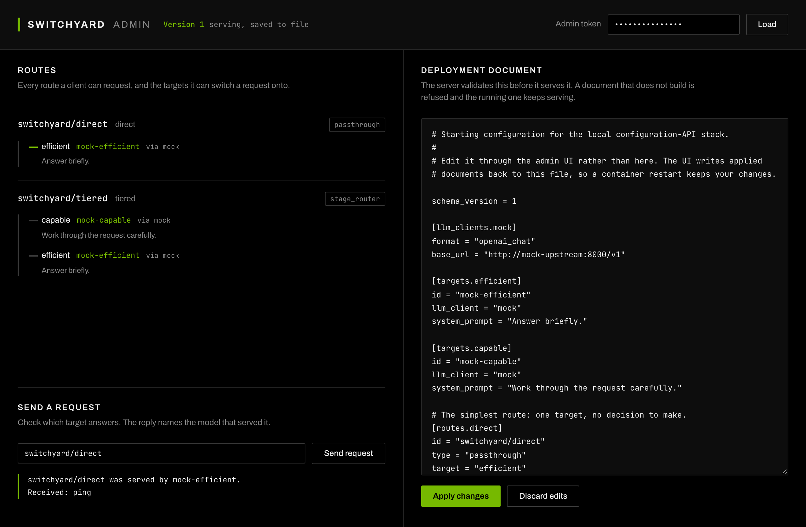

# Switchyard Admin

A local stack for working on the [configuration API](../../docs/reference/config_api.md):
the server, a stub upstream, and a console for driving the API by hand.

Nothing here calls a model provider, so it needs no API key and costs nothing to
run. The console pulls two webfonts from Google Fonts for appearance only; it
falls back to system faces and works fully without them.



## Run it

```bash
cd examples/config-admin
docker compose up --build
```

Open <http://127.0.0.1:8080>, enter the token `local-dev-token`, and press
**Load**.

Set your own token with `SWITCHYARD_ADMIN_TOKEN=... docker compose up --build`,
and move the page with `ADMIN_UI_PORT=9090`.

## What it contains

| Service | What it is |
|---|---|
| `switchyard` | The server, built from this repository, with the configuration API enabled and writing applied documents back to `config/switchyard.toml`. |
| `mock-upstream` | An OpenAI-compatible endpoint that answers without a model. It echoes the prompt, and the reply's `model` field names the target that served it, which is how you see where a route sent a request. |
| `ui` | The Switchyard Admin console: a static page plus the nginx that serves it and forwards `/v1/` to the server. One origin for both means the console needs no CORS handling. |

The server port is not published. Reach the API through the console's origin, so
what you test by hand is the same path the console uses.

`ui` is built from `ui/`, not pulled as a plain nginx, so what runs here is the
image a cluster runs. It publishes as
`ghcr.io/inframaniacs/switchyard-admin-ui`, sharing a tag with
`switchyard-server`. `SWITCHYARD_UPSTREAM` says where to send `/v1/`:
`http://switchyard:4000` here, `http://127.0.0.1:4000` for a sidecar in a
Kubernetes pod.

`ui/index.html` and `ui/app.js` are mounted over the built copies, so an edit
shows up on refresh without a rebuild.

## Try the three things the API is for

**Edit a configuration.** Change the deployment document and press **Apply
changes**. The console sends the version it loaded, so an apply is refused if
something else changed the configuration first.

**See what a route resolves to.** Routes shows every route as a rail branching
into the targets it can switch a request onto, with the model each target names
and its system prompt. This is the view a status page would show.

**Move traffic without a restart.** Send a request to `switchyard/direct` and
note which model answers. Change that route's `target` from `efficient` to
`capable`, apply, and send again. The same process answers with the other model.

**Watch a bad change get refused.** Point a route at a target that does not
exist and apply. The console shows the server's validation error, and the
previous configuration keeps serving. Send a request to confirm nothing moved.

## By hand

```bash
API=http://127.0.0.1:8080
TOKEN=local-dev-token

# What is running
curl -s -H "authorization: Bearer $TOKEN" $API/v1/config | jq

# What each route resolves to
curl -s -H "authorization: Bearer $TOKEN" $API/v1/config/routes | jq

# Which model serves a route
curl -s $API/v1/chat/completions -H 'content-type: application/json' \
  -d '{"model":"switchyard/direct","messages":[{"role":"user","content":"ping"}]}' \
  | jq .model
```

## Notes

`config/` is mounted as a directory, not as a single file. Applied documents are
written to a temporary file and renamed over the original, which needs a
writable directory, and renaming over a single-file bind mount does not work.

The server runs as uid 1000. If an apply reports that the configuration is
serving but was not written, check that `config/` is writable by that uid.

`docker compose down -v` stops the stack. Your edits stay in
`config/switchyard.toml`; `git checkout` that file to start over.
